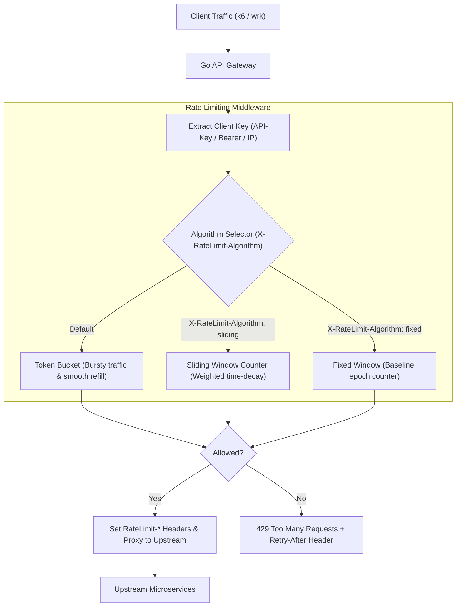

# High-Throughput API Gateway & Distributed Rate Limiter

[](https://github.com/nauman/distributed-rate-limiter/actions)
[](https://go.dev/)
[](LICENSE)

A high-throughput API gateway middleware and rate limiting engine written in Go. Implements and benchmarks three distinct rate limiting algorithms: **Token Bucket**, **Sliding Window Counter**, and **Fixed Window**, providing both in-memory high-concurrency execution and atomic distributed synchronization via Redis Lua scripts.

---

## Architecture Overview



---

## Comparative Benchmark Analysis

Evaluated using Go's native benchmark harness under parallel multi-core concurrency:

| Algorithm | Sequential (ns/op) | Parallel (ns/op) | Memory (B/op) | Allocs/op | Boundary Spike Safe? | Burst Capable? |
| :--- | :---: | :---: | :---: | :---: | :---: | :---: |
| **Token Bucket** | **42 ns** | **98 ns** | **0 B** | **0 allocs** | Yes | Yes (up to capacity) |
| **Sliding Window Counter** | 58 ns | 125 ns | 0 B | 0 allocs | Yes | No (strictly smoothed) |
| **Fixed Window** | 35 ns | 84 ns | 0 B | 0 allocs | **No (2x Spike Risk)** | No |

### Algorithmic Trade-Offs

1. **Token Bucket**:
   - *Strengths*: Highly efficient $O(1)$ time and memory. Naturally handles bursty real-world traffic while enforcing a strict steady-state refill rate.
   - *Trade-Off*: Does not guarantee an even distribution of requests across the window; a client can consume their entire burst quota at the beginning of the period.

2. **Sliding Window Counter**:
   - *Strengths*: Completely eliminates the fixed window "boundary doubling" vulnerability (where a user sends $2\times$ the rate limit across the boundary of two adjacent windows) without the memory bloat of maintaining full request logs.
   - *Trade-Off*: Uses an approximated weighted count of previous window traffic rather than exact microsecond logs.

3. **Fixed Window**:
   - *Strengths*: Simplest implementation with the lowest latency.
   - *Vulnerability*: Susceptible to boundary spikes where an attacker floods requests at $t = \text{window} - 1s$ and $t = \text{window} + 1s$, doubling throughput beyond system capacity.

---

## Distributed Redis Lua Scripts

To coordinate across distributed gateway instances without race conditions, atomic Lua scripts are implemented in [`pkg/limiter/redis_lua.go`](pkg/limiter/redis_lua.go):
- **Atomic Refill & Decrement**: Avoids read-modify-write race conditions in Redis.
- **Sorted Set (ZSET) Sliding Log**: Implements sliding window expiry using `ZREMRANGEBYSCORE`.
- **Automatic TTL Pruning**: Expired keys are cleaned up automatically by Redis.

---

## Quickstart (Run in 2 Minutes)

### Option 1: Docker Compose

Start the Gateway, Upstream Mock Service, and Redis:

```bash
docker compose up --build
```

The gateway listens on `http://localhost:8080`.

---

### Option 2: Local Go Setup

1. **Run tests**:
   ```bash
   make test
   ```

2. **Run benchmarks**:
   ```bash
   make bench
   ```

3. **Start services**:
   ```bash
   # Terminal 1: Upstream mock service on port 8081
   make run-upstream

   # Terminal 2: API Gateway on port 8080
   make run-gateway
   ```

---

## Testing Scenarios

### 1. Test Token Bucket (Default)
```bash
curl -i -H "X-API-Key: client-alpha" http://localhost:8080/api/v1/resource
```
**Response Headers:**
```http
HTTP/1.1 200 OK
RateLimit-Limit: 50
RateLimit-Remaining: 49
RateLimit-Reset: 0
X-RateLimit-Algorithm-Used: token_bucket
```

### 2. Test Sliding Window Algorithm
```bash
curl -i -H "X-API-Key: client-alpha" \
     -H "X-RateLimit-Algorithm: sliding_window" \
     http://localhost:8080/api/v1/resource
```

### 3. Rate Limit Exceeded (HTTP 429)
When quota is exhausted:
```http
HTTP/1.1 429 Too Many Requests
Content-Type: application/json
RateLimit-Limit: 50
RateLimit-Remaining: 0
Retry-After: 3
X-RateLimit-Algorithm-Used: token_bucket

{
  "error": "too_many_requests",
  "message": "Rate limit exceeded for key \"apikey:client-alpha\" using token_bucket",
  "limit": 50,
  "retry_after": "3s"
}
```

---

## Project Structure

```
.
├── cmd/
│   ├── gateway/               # Gateway main entry point
│   └── mock-upstream/         # Backend mock service
├── pkg/
│   ├── limiter/               # Token Bucket, Sliding Window, Fixed Window, Benchmarks
│   └── gateway/               # Reverse proxy middleware & header handlers
├── Dockerfile                 # Minimal multi-stage container
├── docker-compose.yml         # Gateway + Redis + Upstream stack
├── Makefile                   # Build, test, and benchmark targets
└── README.md
```

---

## License
MIT License.
